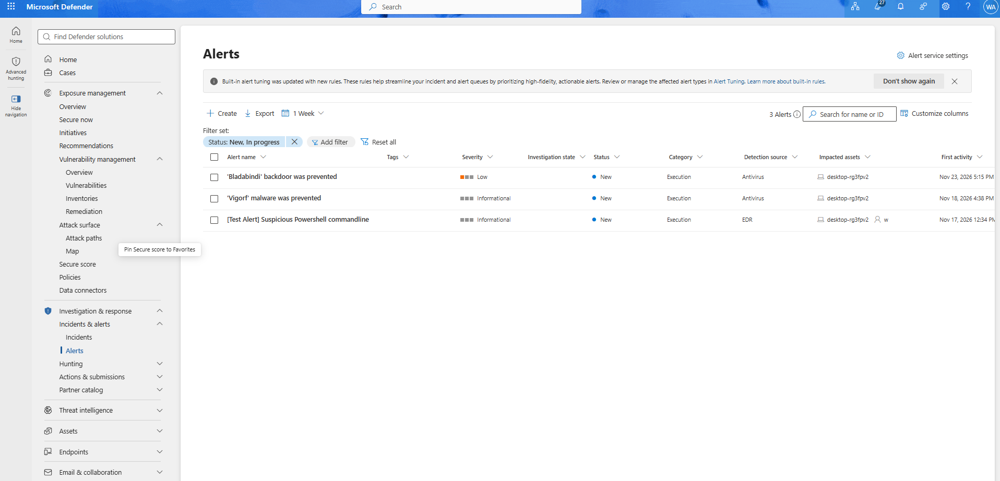
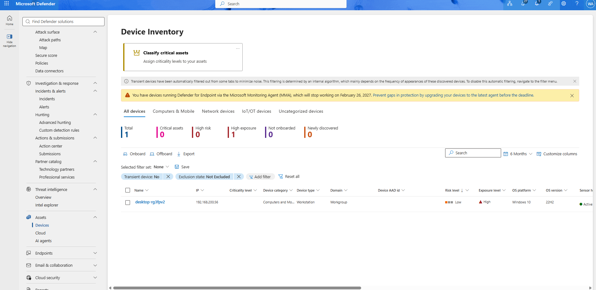
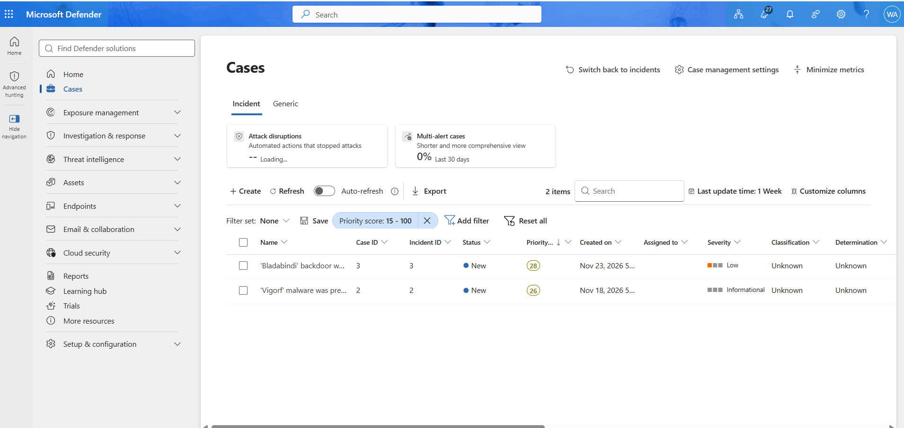
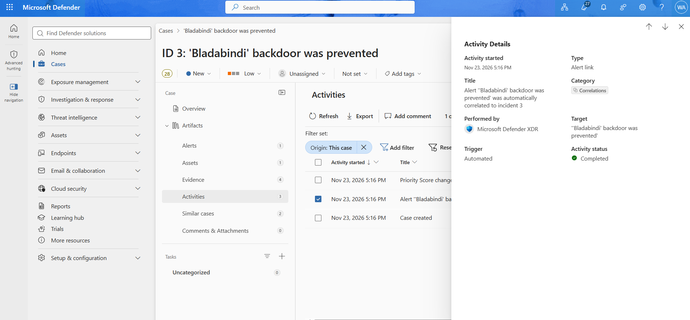
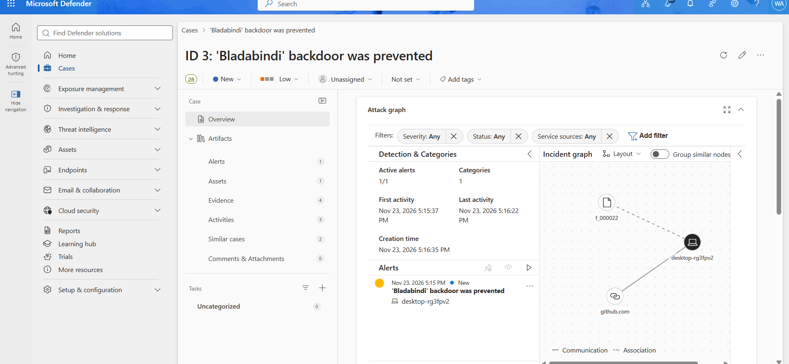
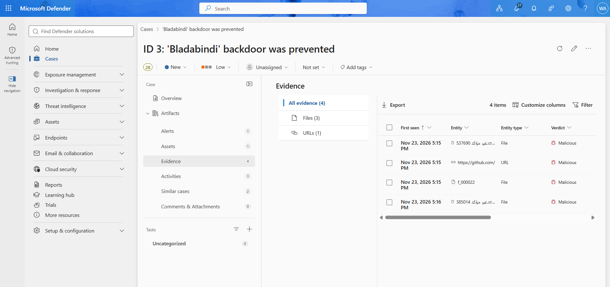
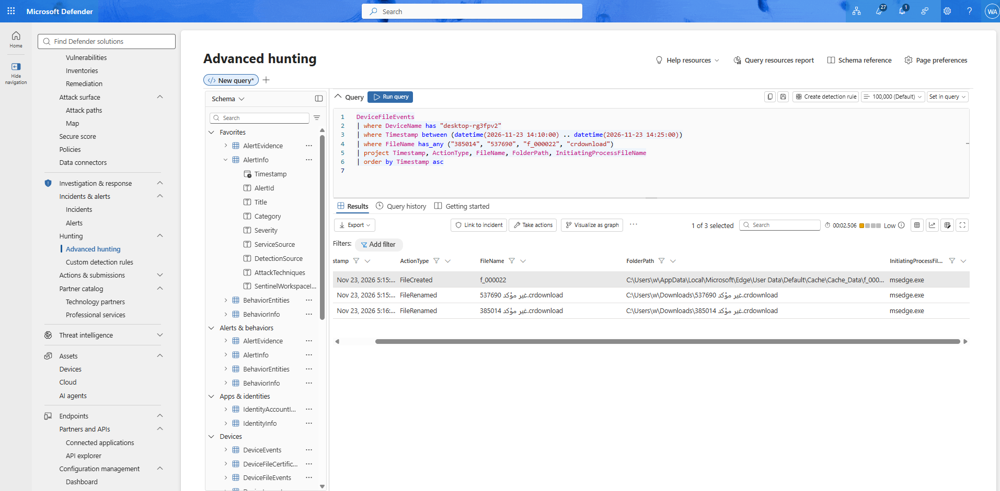

# 🛡️ Microsoft Defender EDR - SOC Labs

Hands-on Security Operations Center (SOC) incident investigations and KQL threat hunting using **Microsoft Defender for Endpoint**.

---

## 📂 Lab 01: Bladabindi (njRAT) Backdoor Investigation

### 1. Incident Overview
* **Alert Title:** `'Bladabindi' backdoor was prevented`
* **Affected Host:** `desktop-rg3fpv2`
* **Status:** Closed (`True Positive - Malware`)
* **Summary:** `msedge.exe` attempted to download a Bladabindi backdoor from GitHub (`537690.crdownload`, `385014.crdownload`, `f_000022`). Microsoft Defender intercepted and quarantined the files before execution.

---

### 2. Investigation & Evidence Timeline

**Step 1: Malware Download Attempt & Detection Alert**



**Step 2: Affected Endpoint Details**


**Step 3: Case Correlation & Manual Alert Creation**





**Step 4: Incident Investigation & VirusTotal Analysis**


---

### 3. Threat Hunting (KQL Queries)

**1. Check Process Execution (0 Results - Confirmed Clean):**
```kql
DeviceProcessEvents
| where FileName =~ "NJRat.exe"
| where ProcessCommandLine has "DownloadFile"
| project Timestamp, DeviceName, AccountName, ProcessCommandLine
```

**2. Trace Browser Download & Cache Artifacts:**
```kql
DeviceFileEvents
| where DeviceName has "desktop-rg3fpv2"
| where Timestamp between (datetime(2026-11-23 14:10:00) .. datetime(2026-11-23 14:25:00))
| where FileName has_any ("385014", "537690", "f_000022", "crdownload")
| project Timestamp, ActionType, FileName, FolderPath, InitiatingProcessFileName
| order by Timestamp asc
```

**KQL Hunting Results:**


---

### 4. Incident Closure
Verified endpoint cleanliness and closed the case as **True Positive (Malware - Prevented)**.


